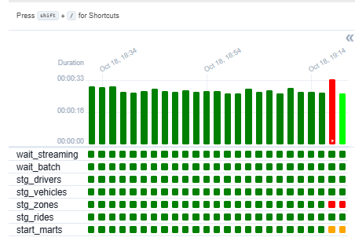

# ANSWERS — InDrive Ride Pipeline (Light version)

Name: Boumaize Fatima-ezzahra

Short answers (1-3 sentences). Write them as you go.

## Q1 — Which sources are **batch** and which is **streaming**? 
## Why does the data team handle them differently? 
## Which one is the **fact** and which are the **dimensions**?

Your answer: ------------------------

- Which sources are **batch** and which is **streaming**? 

Batch sources are the 3 CSV files (drivers, vehicles, zones). Streaming is the API for rides.

- Why does the data team handle them differently? 

The data team handles them differently because batch data is static and updated periodically, while streaming data arrives continuously in real-time. 

- Which one is the **fact** and which are the **dimensions**?

rides is the fact table, and drivers, vehicles, zones are dimensions.

## Q2 — Is this pipeline **ETL** or **ELT**? Justify in 1-2 sentences, using the 3 layers.

Your answer: ------------------------

This pipeline is ELT. The data is first extracted and loaded raw into the raw schema (Postgres), and then transformations are applied inside the database to create the staging and mart tables.

## Q3 — Write the grain of `mart.rides` in one sentence: "one row = ..."

Your answer: ------------------------

One row = one unique ride event made by a driver.

## Q4 — `staging.zones` is joined twice in `mart.rides`. What do we call this pattern? Why not make two zone tables?

Your answer: ------------------------

This is called a Self-Join 

## Q5 — How many rides are in `raw.rides`, in `staging.rides`? 
## Where did the others go? 
## Why is filtering in staging better than letting the `JOIN` in the mart drop them silently?

Your numbers: `raw.rides` = 510 ; `staging.rides` = 473

Your answer: ------------------------

- Where did the others go? 

The missing rows were filtered out because they either had a fare_amount <= 0 or driver_id = 999

- Why is filtering in staging better than letting the `JOIN` in the mart drop them silently?

Filtering in staging is better because it isolates data quality issues early, keeping the mart layer clean and preventing silent data loss during complex joins.

## Q6 — You re-run `3_staging` three times. Why is there no duplicate?
## What would happen if the SQL used `INSERT INTO` instead of `DROP` + `CREATE TABLE AS`?

Your answer: ------------------------

- You re-run `3_staging` three times. Why is there no duplicate?

There is no duplicate because the SQL uses DROP TABLE IF EXISTS followed by CREATE TABLE AS.

- What would happen if the SQL used `INSERT INTO` instead of `DROP` + `CREATE TABLE AS`?

If it used INSERT INTO, running it 3 times would append the same data 3 times, creating duplicates.

## Q7 — Is `fare_amount` additive, semi-additive or non-additive? 
## And `rating`? 
## What would be wrong with `SUM(rating)`?

Your answer: ------------------------

- Is `fare_amount` additive, semi-additive or non-additive? 

fare_amount is additive (you can sum it up across all dimensions) 

- And `rating`? 

rating is non-additive 

-  What would be wrong with `SUM(rating)`?

Using SUM(rating) would give you a meaningless number, we should use AVG(rating) instead.

## Q8 — The back office changes a driver's rating in `drivers.csv` and `2_batch` reloads it. 
## What happens to the **old** rides of this driver in `mart.rides`? 
## Is it correct for InDrive? 
## Which technique would keep the rating the driver had *at the time of the ride*?

Your answer: ------------------------

- What happens to the **old** rides of this driver in `mart.rides`? 

Because mart.rides is rebuilt using the current staging.drivers table, the old rides will now show the new rating. 
It is the Type 1 Slowly Changing Dimension (overwrite). 

- Is it correct for InDrive? 

For InDrive, this is usually incorrect (historical data should reflect what happened at that time).

- Which technique would keep the rating the driver had *at the time of the ride*?

To keep the rating at the time of the ride, we would need to implement SCD Type 2 (creating a new row with a start/end date for the driver every time their rating changes, and joining on the date).

## Bonus (optional)

- New mart `mart.revenue_by_vehicle_type`: paste your SQL here.

    DROP TABLE IF EXISTS mart.revenue_by_vehicle_type;

    CREATE TABLE mart.revenue_by_vehicle_type AS
    SELECT 
        v.vehicle_type,
        COUNT(r.ride_id) AS rides,
        ROUND(SUM(r.fare_amount), 2) AS revenue
    FROM mart.rides r
    JOIN staging.vehicles v ON r.driver_id = v.driver_id
    GROUP BY v.vehicle_type
    ORDER BY revenue DESC;

- Break it (`raw.zonez`): what did you see in the Airflow logs?

stg_zones est rouge : Elle a échoué car la table n'existe pas.

start_marts est orange : Le petit carré orange signifie "Upstream Failed" (la tâche précédente a échoué). Airflow a automatiquement annulé le déclenchement du DAG 4_marts parce qu'il manquait une brique (les zones).

Les autres tâches (stg_drivers, stg_vehicles, stg_rides) sont vertes : Elles ont bien réussi car elles ne dépendent pas de la table zones. Elles ont tourné en parallèle sans être impactées.

wait_streaming et wait_batch sont vertes : Les capteurs ont bien attendu les données, mais la suite a bloqué à cause de l'erreur SQL.